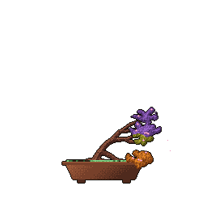
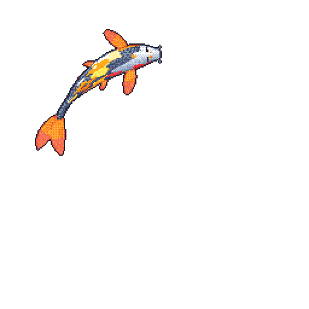

  

  I build web applications and backend systems with .NET, React, and Go, with an interest in software efficiency.

  
  

## Selected projects

<table>
  <tbody>
    <tr>
      <td width="850">
        <h3>Vouch</h3>
        

        
<strong>One considered match a day for university students, with peer endorsements and letter-style conversations.</strong> 
        The backend combines trust scoring, match ranking, and real-time letter delivery through SignalR.

        
<code>ASP.NET Core</code> · <code>React</code> · <code>TypeScript</code> · <code>PostgreSQL</code>

        
<a href="https://github.com/thimira20011/Vouch-Backend"><strong>Explore backend →</strong></a> &nbsp;·&nbsp; <a href="https://github.com/thimira20011/Vouch-Frontend"><strong>Explore frontend →</strong></a>

      </td>
    </tr>
  </tbody>
</table>

<table>
  <tbody>
    <tr>
      <td width="850">
        <h3>GreenOps Intelligence Hub</h3>
        

        
<strong>Turns Azure resource usage into software carbon intensity estimates.</strong> 
        Polls Azure metrics every 60 seconds and uses Roslyn to flag .NET performance anti-patterns.

        
<code>.NET</code> · <code>Azure</code> · <code>Roslyn</code> · <code>Docker</code>

        
<a href="https://github.com/thimira20011/GreenOps-Intelligence-Hub"><strong>Explore GreenOps →</strong></a>

      </td>
    </tr>
  </tbody>
</table>

<table>
  <tbody>
    <tr>
      <td width="850">
        <h3>AyurFlow</h3>
        

        
<strong>A clinic management system in development for an Ayurvedic pilot.</strong> 
        Staff sessions and protected patient demographics APIs are in place. UI integration is pending.

        
<code>Go</code> · <code>Gin</code> · <code>PostgreSQL</code> · <code>Next.js</code>

        
<a href="https://github.com/thimira20011/AyurFlow"><strong>Explore AyurFlow →</strong></a>

      </td>
    </tr>
  </tbody>
</table>

## GitHub garden

  
  

  <a href="https://github.com/thimira20011#year-list-container">
    <picture>
      <source media="(prefers-color-scheme: dark)" srcset="https://streak-stats.demolab.com/?user=thimira20011&amp;hide_border=true&amp;timezone=Asia%2FColombo&amp;card_width=620&amp;card_height=180&amp;disable_animations=true&amp;theme=dark&amp;background=0D1117&amp;ring=58A6FF&amp;fire=58A6FF&amp;currStreakLabel=79C0FF" />
      
    </picture>
  </a>

  <picture>
    <source media="(prefers-color-scheme: dark)" srcset="https://github-profile-summary-cards.vercel.app/api/cards/stats?username=thimira20011&amp;theme=github_dark" />
    
  </picture>
  <picture>
    <source media="(prefers-color-scheme: dark)" srcset="https://github-profile-summary-cards.vercel.app/api/cards/repos-per-language?username=thimira20011&amp;theme=github_dark" />
    
  </picture>

