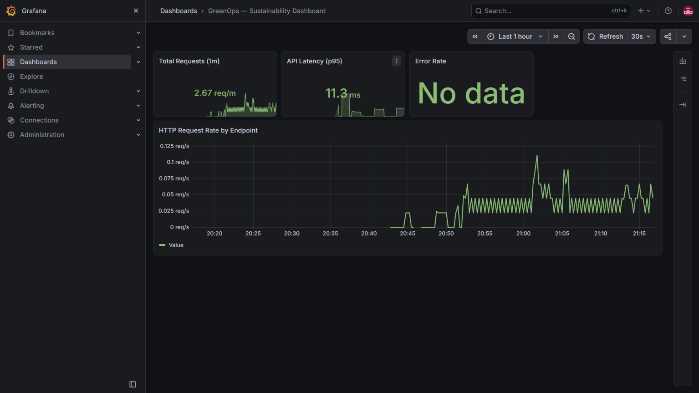
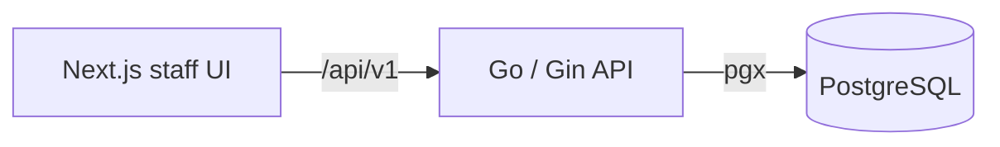

  

  I build web applications and backend systems with .NET, React, and Go, with an interest in software efficiency.

  
  

  <strong>NearU engineering highlight</strong> 
  Led a four-person team and cut the backend container image by <strong>49% (213 MB → 108 MB)</strong> using Ubuntu Chiseled.
  <a href="https://github.com/Nearu-Project-SUSL/NearU-Backend/blob/HEAD/Dockerfile">View the Dockerfile →</a>

## Selected projects

<table>
  <tbody>
    <tr>
      <td width="850">
        <h3>GreenOps Intelligence Hub</h3>
        

        
Turns Azure resource usage into software carbon intensity estimates and flags .NET performance anti-patterns with Roslyn.

        
<strong>My contribution:</strong> Built the 60-second Azure telemetry collector and carbon-intensity calculations, then integrated Prometheus and Grafana.

        

        
Grafana dashboard showing API latency and request traffic.

        
<code>.NET</code> · <code>Azure</code> · <code>Roslyn</code> · <code>Docker</code>

        
<a href="https://github.com/thimira20011/GreenOps-Intelligence-Hub#-quick-start"><strong>Run the demo →</strong></a> &nbsp;·&nbsp; <a href="https://github.com/thimira20011/GreenOps-Intelligence-Hub">Source</a>

      </td>
    </tr>
  </tbody>
</table>

<table>
  <tbody>
    <tr>
      <td width="850">
        <h3>Vouch</h3>
        

        
One considered match a day for university students, with peer endorsements and letter-style conversations.

        
<strong>My contribution:</strong> Designed the backend architecture around campus access, trust scoring, and daily matching.

        
<code>ASP.NET Core</code> · <code>React</code> · <code>TypeScript</code> · <code>PostgreSQL</code>

        
<a href="https://github.com/thimira20011/Vouch-Frontend#connection-screens-and-design-preview"><strong>Run the preview →</strong></a> &nbsp;·&nbsp; <a href="https://github.com/thimira20011/Vouch-Backend">Backend source</a> &nbsp;·&nbsp; <a href="./assets/projects/vouch-preview.png">View screenshot</a>

      </td>
    </tr>
  </tbody>
</table>

<table>
  <tbody>
    <tr>
      <td width="850">
        <h3>AyurFlow</h3>
        

        
A team project building the foundations for an Ayurvedic clinic pilot. UI integration is in progress.

        
<strong>My contribution:</strong> Implemented staff sessions, CSRF protection, and authorization checks for protected patient records.

        
<code>Go</code> · <code>Gin</code> · <code>PostgreSQL</code> · <code>Next.js</code>

        
<a href="https://github.com/thimira20011/AyurFlow/commit/b415a14e2d129fc2dab1c4273bd18b6984cf6309"><strong>See the authorization work →</strong></a> &nbsp;·&nbsp; <a href="https://github.com/thimira20011/AyurFlow">Source</a> &nbsp;·&nbsp; <a href="./assets/projects/ayurflow-staff-sign-in.webp">View sign-in design</a>

      </td>
    </tr>
  </tbody>
</table>

AyurFlow architecture at a glance

## GitHub garden

  
  

  <a href="https://github.com/thimira20011#year-list-container">
    <picture>
      <source media="(prefers-color-scheme: dark)" srcset="https://streak-stats.demolab.com/?user=thimira20011&amp;hide_border=true&amp;timezone=Asia%2FColombo&amp;card_width=620&amp;card_height=180&amp;disable_animations=true&amp;theme=dark&amp;background=0D1117&amp;ring=58A6FF&amp;fire=58A6FF&amp;currStreakLabel=79C0FF" />
      
    </picture>
  </a>

  <picture>
    <source media="(prefers-color-scheme: dark)" srcset="https://github-profile-summary-cards.vercel.app/api/cards/stats?username=thimira20011&amp;theme=github_dark" />
    
  </picture>
  <picture>
    <source media="(prefers-color-scheme: dark)" srcset="https://github-profile-summary-cards.vercel.app/api/cards/repos-per-language?username=thimira20011&amp;theme=github_dark" />
    
  </picture>

